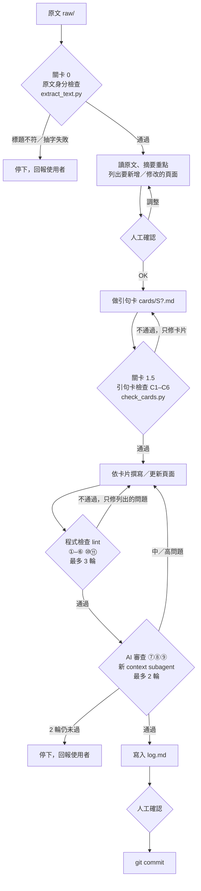
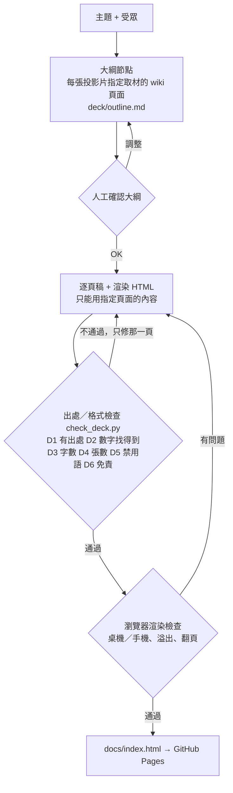

# 早餐一定要吃嗎？——用 LLM Wiki 做教學 HTML 簡報

> 生成式 AI 課程作業：先用「先討論、後生成」建立 LLM Wiki，再用 Wiki 當唯一知識來源，產生一份教學 HTML 簡報。
> 執行者：AI coding agent（Claude Code）；展示：GitHub。

| 繳交項目 | 位置 |
|---|---|
| 1. Wiki 主題與介紹 | [本頁第 1 節](#1-wiki-主題與介紹) |
| 2. LLM Wiki 成果 | [wiki/index.md](wiki/index.md)（15 頁）、規則 [AGENTS.md](AGENTS.md)、資料 [sources.md](sources.md) |
| 3. 教學 HTML 簡報 | **GitHub Pages：<https://yjy-ying.github.io/llm-wiki/>**；原始檔 [docs/index.html](docs/index.html) |
| 4. loop / graph 設計 | [本頁第 3 節](#3-loop--graph-設計) |
| 5. 實際執行與檢查紀錄 | [本頁第 4 節](#4-實際執行與檢查紀錄)、完整紀錄 [wiki/log.md](wiki/log.md)、git 歷史 |
| 6. 反思 | [本頁第 5 節](#5-反思) |

---

## 1. Wiki 主題與介紹

**主題**：早餐一定要吃嗎？研究證據整理

**為什麼選這個主題**：每個人都有經驗，而且研究**真的互相矛盾**：觀察型研究發現「不吃早餐」與心臟病、過重相關；把人隨機分組的實驗卻發現吃早餐對減重沒有幫助。這很適合練習 LLM Wiki 的「矛盾並列」與「忠實度檢查」，也能教新手一個重要觀念：**相關不等於因果**。

**讀者**：完全不懂這個主題、也不懂研究方法的人。

**已 ingest 的資料（5 篇）**

| 編號 | 資料 | 類型 |
|---|---|---|
| S6 | Shmerling 2017, Harvard Health Blog | 科普文章 |
| S1 | Cahill et al. 2013, *Circulation* | 前瞻性世代研究（觀察型） |
| S3 | Dhurandhar et al. 2014, *AJCN* | 隨機對照試驗 |
| S4 | Betts et al. 2014, *AJCN* | 隨機對照試驗 |
| S5 | Sievert et al. 2019, *BMJ* | RCT 的統合分析 |

另有 S2（Rong 2019）、S7（S2 的社論）已下載並通過原文檢查，因時間改用精簡模式而未 ingest。原文 PDF 因著作權不上傳，連結見 [sources.md](sources.md)。

## 2. LLM Wiki 成果

```
AGENTS.md          ← 10 題訪談後生成的 wiki 規則（agent 的員工手冊）
CLAUDE.md          ← @AGENTS.md
sources.md         ← 書目 + 已知來源差異
cards/S?.md        ← 引句卡（graph v2 新增）
scripts/           ← 每個檢查關卡一支腳本
wiki/
├── index.md  log.md  glossary.md
├── studies/   研究頁 ×5
├── concepts/  概念頁 ×5（干擾因子、中介因子、世代研究、相對風險、觀察 vs RCT）
├── topics/    主題頁 ×3（最重要的一餐？變胖？心臟病？）
└── debates/   爭議頁 ×1（不吃早餐的人之後會補吃嗎？）
docs/index.html    ← 教學簡報
```

**「先討論、後生成」怎麼做的**：agent 先不建任何檔案，一次問一題，共 10 題：讀者、頁面類型、語言、出處粒度、矛盾怎麼處理、一次一篇或批次、之後產出什麼、lint 檢查什麼、詳細程度、檔名與連結格式。問完整理成需求摘要，我要求寫得更詳細、確認後，才生成 [AGENTS.md](AGENTS.md)。生成後再逐條對照摘要。

**Wiki 與簡報的對應**：每張投影片都標出取材的 wiki 頁面（`data-src`），而且 `scripts/check_deck.py` 會檢查投影片上的**每個數字都必須出現在它引用的 wiki 頁面中**。

| 投影片 | 取材的 wiki 頁面 |
|---|---|
| 1–2 最重要的一餐？ | [topics/most-important-meal](wiki/topics/most-important-meal.md) |
| 3 觀察 vs 實驗 | [concepts/observational-vs-rct](wiki/concepts/observational-vs-rct.md) |
| 4 風險高 27% | [studies/cahill-2013](wiki/studies/cahill-2013.md)、[concepts/relative-risk](wiki/concepts/relative-risk.md) |
| 5 干擾因子 | [concepts/confounding](wiki/concepts/confounding.md) |
| 6 調整越多數字越小 | [concepts/mediator](wiki/concepts/mediator.md) |
| 7 實驗 1 | [studies/dhurandhar-2014](wiki/studies/dhurandhar-2014.md) |
| 8 實驗 2 | [studies/betts-2014](wiki/studies/betts-2014.md) |
| 9 統合分析 | [studies/sievert-2019](wiki/studies/sievert-2019.md) |
| 10 爭議 | [debates/do-skippers-eat-more-later](wiki/debates/do-skippers-eat-more-later.md) |
| 11 整理 | [topics/breakfast-and-weight](wiki/topics/breakfast-and-weight.md)、[topics/breakfast-and-heart](wiki/topics/breakfast-and-heart.md) |
| 12 三個問題 | [concepts/observational-vs-rct](wiki/concepts/observational-vs-rct.md)、[concepts/confounding](wiki/concepts/confounding.md) |

## 3. loop / graph 設計

設計原則（來自課程講義）：**流程事先畫好（graph）、每個關卡內可以反覆修（loop）、「做完了」由腳本說了算、AI 審查開新 context 只看成品和原文、每個 loop 都有剎車。**

### Graph A：建 Wiki（ingest，每篇資料跑一次）——最終版 v2



### Graph B：Wiki → 教學簡報



### 哪些步驟會重複？哪裡要檢查或重新生成？

| 會重複的 loop | 怎麼停 |
|---|---|
| 每篇資料跑一次 Graph A | 5 篇完成 |
| 引句卡 ↔ 卡片檢查 | 全過；最多 3 輪 |
| 撰寫 ↔ lint | 全過；最多 3 輪，只修報告列出的問題 |
| 撰寫 ↔ AI 審查 | 無中／高問題；最多 2 輪，仍未過就停下交給人 |
| 逐頁稿 ↔ 簡報檢查 | 全過；只修有問題的那一頁 |

**檢查分兩種**：🧮 程式檢查（斷連結、缺出處、引句是否逐字存在於原文、孤兒頁、格式、禁用語、限定詞是否保留、簡報數字是否找得到）是便宜、可重複、結果明確的關卡；🧑‍⚖️ AI 審查（翻譯忠實、有沒有講反或誇大、矛盾有沒有並列）是語意判斷，**用新的 subagent，只給頁面和原文**，不讓寫的人審自己。

### 為什麼這樣設計？

- **流程寫死、退回路線事先畫好**：錯在哪一關就退回哪一關，不用整份重來。
- **能用腳本檢查的就不用 AI**：腳本說「沒過」就是沒過，不會被說服。
- **人只在關鍵節點介入**：要寫哪些頁面、簡報大綱、要不要 commit。
- **每個 loop 都有剎車**：輪數上限、資料不足就停、原文不對就停。

### Graph 的三個版本

| 版本 | 改了什麼 | 為什麼 |
|---|---|---|
| v1 | 關卡 0 → 撰寫 → lint ①–⑥ → AI 審查 | 初始設計 |
| **v2** | 在撰寫**之前**加「引句卡＋關卡 1.5」，lint 加 ⑩⑪ | S6 在 v1 跑滿 2 輪 AI 審查仍未過，錯誤集中在撰寫節點的限定詞（見第 5 節） |
| v3（精簡模式） | 卡片只收數字／結論／限制；三篇批次；AI 審查合併一輪 | 時間成本：保留便宜的自動檢查，縮減昂貴的 AI 審查輪數 |

## 4. 實際執行與檢查紀錄

完整紀錄在 [wiki/log.md](wiki/log.md)，每篇 ingest 都有獨立 commit。摘要如下：

| 執行 | 程式檢查 | AI 審查 | 結果 |
|---|---|---|---|
| 關卡 0（7 份原文） | 抓到**放錯論文**（02 號檔其實是社論）、S6 標題抽取 bug | — | 換檔、修腳本後全過 |
| S6（graph v1） | lint 2 輪 | 第 1 輪 18 題（中 9）、第 2 輪 16 題（中 4） | ❌ 跑滿 2 輪未過，**依規則停下** |
| S6（graph v2 重跑） | 卡片 26 張；v2 檢查掃 v1 頁面抓到 12 題 | 第 1 輪 11 題（**中 1**）、第 2 輪 9 題（全低） | ✅ 通過 |
| S1（v2） | lint 3 輪（調整一條規則） | 15 題（中 4） | 修中度後 commit |
| S3＋S4＋S5（v3 批次） | 卡片 42 張一次過、lint 一次過 | 9 題（中 5） | 修中度後 commit |
| 簡報 | 第 1 輪 4 題（1 個真的：簡報自己生出「1.00」）| — | 第 2 輪全過；瀏覽器檢查修 1 個翻頁 bug |

**v1 vs v2（同一篇 S6，AI 審查第 1 輪）**：18 題（中 9）→ 11 題（中 1）。

另外發現的資料問題（記在 [sources.md](sources.md)）：S1 論文內部「高 50%」與「RR 1.55」不一致、S1 摘要與討論的語氣不同、S5 表格列的 S3 樣本數（204）與 S3 論文（309）不同、S3 PDF 抽字把負號和 ± 轉成「2」「6」。

## 5. 反思

### 哪一個節點最常出錯？

最常出錯的是「寫頁面」這一步，而且加了檢查之後，出錯的地方還會跑到別的地方。

- **一開始（v1）是句子寫錯。** S6 第一次跑，AI 審查兩輪總共抓到 34 個問題，大部分都是同一種：原文寫 *suggested、tend to、unlikely* 這種比較保留的字，結果被寫得太肯定；或是把「文章轉述別人的研究」寫成「文章指出」。我原本的程式檢查只看英文引句有沒有在原文裡，引句本身都對，錯的是上面那行中文，所以一定要等到最後的 AI 審查才會發現，每次都要整頁重改。
- **加了引句卡之後，換成「整理重點」出錯。** 後面 S1、S3～S5 的中度問題，幾乎沒有限定詞的錯了，反而變成一句話重點寫得太簡單（例如把 S3 測的「建議吃早餐」寫成「吃早餐」）、只寫一邊的說法，或漏掉跟其他篇矛盾的結果。我的感覺是引句卡可以管好每一句話，但管不到跨好幾篇資料的整理。
- **檢查程式自己也會出錯。** 像是把 Wiki 的標題「早餐一定要吃嗎」當成禁止用語，或把我有標明是教學說明的段落當成沒有出處；簡報檢查也曾經把兩個數字黏在一起。所以每次沒過，我都要先判斷是內容錯還是檢查錯。

### 把檢查往前移到哪一個步驟？

| 問題 | 原本在哪裡才發現 | 往前移到 | 做法 |
|---|---|---|---|
| 放錯論文（02 號是社論） | 人工打開檔案才發現 | **關卡 0**：ingest 最前面 | 腳本比對原文標題與書目、檢查文字長度 |
| 限定詞被改、轉述寫成指出 | 最後的 AI 審查 | **關卡 1.5**：撰寫之前 | 先做引句卡（限定詞、主詞、比較對象），腳本強制中文保留，例如 suggested 不可譯成「顯示」 |
| 簡報自己生出數字 | 人眼看簡報 | **渲染之前**的出處檢查 | 投影片上每個數字都必須出現在它引用的 Wiki 頁面 |

### 有沒有因此修改 workflow／graph？為什麼？

有，總共改了兩次（流程圖在第 3 節，數字在第 4 節）。

1. **v1 → v2：在寫之前先做引句卡。** 因為錯誤大多集中在寫頁面，而且是有規則、可以用程式檢查的錯（限定詞），所以我想與其最後整頁重寫，不如在一開始就擋下來。同一篇 S6 重跑之後，第一輪的中度問題從 9 個變成 1 個，第二輪就過了。
2. **v2 → v3：改成精簡模式。** 完整的 v2 每篇都要跑好幾輪 AI 審查，花太多時間，所以後面三篇我保留跑得很快的程式檢查，把 AI 審查併成一輪、只修中高度的問題。結果中度問題又變回 5 個，可見少一輪審查還是有差，這是我在時間和品質之間做的取捨。
3. **檢查規則也一起改。** 例如明確寫「本 wiki 的教學說明」的段落可以不用資料編號，不然會逼人亂加編號只為了過關。每次改規則都有寫進 AGENTS.md。

如果再做一次，我會再把檢查往前移一格：做完引句卡之後，先讓 AI 只審卡片（因為卡片本身翻錯的時候，程式是抓不出來的），也會要求每一句重點都要能對應到頁面裡的某張卡片，這樣整理重點這一步也能用程式檢查。

---

*本 wiki 與簡報僅供教學，不構成醫療建議。*
